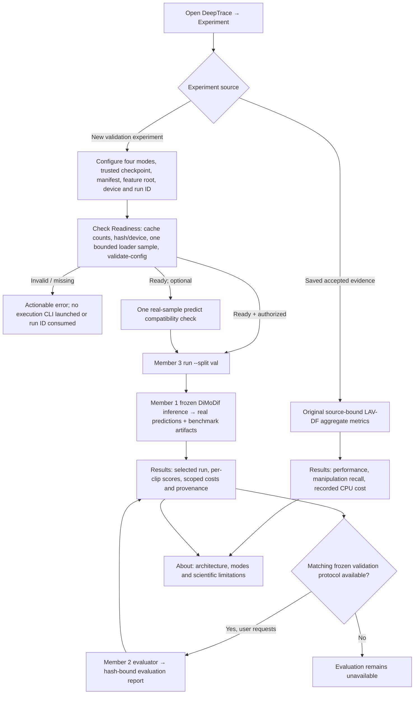
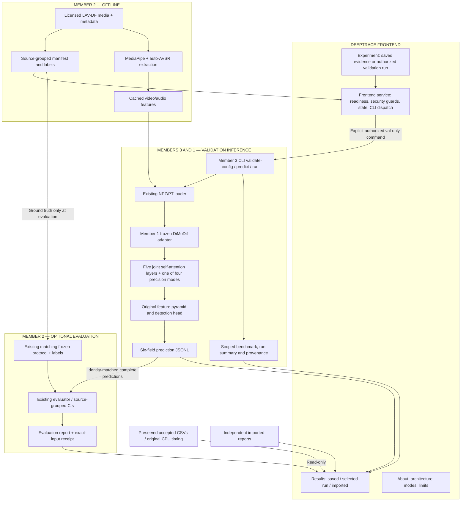

# AVFuse-CausalQ

## IO-Aware, Precision-Controlled Audio-Visual Fusion for Deepfake Detection

**A controlled experimental study of how simulated low-precision attention affects the forensic decisions of a frozen, pretrained audiovisual deepfake detector—and whether selectively preserving precision improves those decisions at a measured computational cost.**

AVFuse-CausalQ combines a real pretrained **DiMoDif** detector, **LAV-DF** whole-video data, four precisely defined attention modes, source-aware evaluation, CPU benchmarking, reproducible artifacts, and a three-section **DeepTrace Precision Experimentation Workbench (Experiment · Results · About)**. The accepted scientific study is complete; this repository also documents its negative findings and limitations rather than presenting the hoped-for optimization as a success.

> **Main finding:** On the selected LAV-DF cohort, simulated INT8-style rounding of joint-attention activations caused small numerical changes, but **overall precision-induced degradation was not statistically established**. Restoring precision in **V and the attention output** was **not shown to outperform restoring Q**. The measured costs are for floating-point fake quantization on cached features, **not native INT8 acceleration**.

**Project status (November 2026):** The accepted scientific backend and redesigned **[DeepTrace Precision Experimentation Workbench](https://github.com/SudarshanG9/AFML-project/tree/main/frontend)** are integrated on [`main`](https://github.com/SudarshanG9/AFML-project/tree/main). The [workbench integration record](frontend/INTEGRATION.md) reports 1,235 local test passes / 22 skips and local UI checks; full licensed-checkpoint validation inference through the redesigned interface has **not** been demonstrated.

### Contents

1. [Problem statement and research question](#1-problem-statement-and-research-question)
2. [Research hypotheses and objectives](#2-research-hypotheses-and-objectives)
3. [Technical choices, models, and datasets](#3-technical-choices-models-and-datasets)
4. [System architecture and complete data flow](#4-system-architecture-and-complete-data-flow)
5. [Research design and evaluation methodology](#5-research-design-and-evaluation-methodology)
6. [Project structure and team ownership](#6-project-structure-and-team-ownership)
7. [Research journey: experiments, findings, and decisions](#7-research-journey-experiments-findings-and-decisions)
8. [Final experimental results](#8-final-experimental-results)
9. [Conclusions and answers to the hypotheses](#9-conclusions-and-answers-to-the-hypotheses)
10. [Using the system and reproducing the evidence](#10-using-the-system-and-reproducing-the-evidence)
11. [Limitations and future directions](#11-limitations-and-future-directions)
12. [References, datasets, and further reading](#12-references-datasets-and-further-reading)

---

## 1. Problem statement and research question

### The problem in simple terms

Deepfake detection becomes difficult when a video and its soundtrack can be manipulated **independently**. A clip might show a real person speaking with generated audio; an authentic voice might accompany an altered face; or both modalities may be fake. Inspecting only the image or only the sound can miss evidence present in the other stream.

An audiovisual (AV) deepfake detector jointly processes video and audio features. A transformer-style **attention** mechanism decides which parts of those sequences are relevant to one another. But the attention operation must move and calculate numerical values, which can be expensive on constrained hardware.

A common efficiency idea is to **reduce numerical precision**—for example, representing some values on an 8-bit grid instead of preserving their full 32-bit floating-point resolution. This raises a forensic question: **Could a seemingly small rounding error erase a subtle clue that distinguishes authentic from manipulated content?** And if so, could we preserve precision only in the important part of attention rather than everywhere?

It is not sufficient to show that an attention tensor looks similar or that a model runs faster. We must measure whether the **true-label detection decisions** change, separately for audio-only, video-only, and combined manipulation, and quantify the cost of each choice.

### Research question

> Under a source-disjoint, manipulation-stratified evaluation, does reducing numerical precision inside audiovisual fusion measurably change deepfake detection decisions? If damage occurs, can keeping higher precision in the **value/attention-output path** recover more of it than keeping higher precision in the **query path**, at a comparable cost measured on real hardware?

**Scope:** We investigate *one frozen detector and its attention arithmetic*. We do **not** claim to invent deepfake detection, train a new model, develop a new quantization algorithm, build a custom FlashAttention alternative, or demonstrate deployment-ready INT8 speedups.

For context, see [research foundations](docs/01_RESEARCH_FOUNDATIONS.md) and [literature/novelty review](docs/02_LITERATURE_REVIEW_AND_NOVELTY.md).

## 2. Research hypotheses and objectives

The project began with three explicit hypotheses. They describe **what we expected**, not what the final data necessarily proved.

| ID | Original expectation | How we tested it | Final assessment |
| --- | --- | --- | --- |
| **H1 — IO-aware engineering** | Real attention shapes would not justify writing a new custom tiled attention kernel; an existing optimized implementation should suffice for this scope. | Inspect real Q/K/V shapes, masks, analytical dense-memory size, dense-versus-SDPA correctness, and recorded runtime. | **Supported as an engineering scope decision**, not proof that no device could have a memory bottleneck. |
| **H2 — Precision sensitivity** | Rounding Q/K/V and the attention output to a simulated INT8 grid would measurably worsen label-grounded detection, potentially differently for audio, video, and combined fakes. | Compare paired FP32 and low-precision outputs using BCE, AUROC, AP, recall, and FPR, overall and by fake type. | **Overall degradation not supported**; manipulation-dependent degradation **inconclusive**. |
| **H3 — Selective precision restoration** | Preserving V and the attention output should recover more detection quality than preserving Q, ideally at comparable extra cost. | Compare V/output restoration, Q restoration, and low precision on the *same clips*, using paired loss intervals and measured runtime. | **Overall V/output advantage not supported**; comparable restoration cost **not established**. |

Our intended contribution was a **falsifiable, reproducible answer**, even if the optimal precision policy we hoped to discover did not exist for this detector. This principle is important: *a well-executed experiment with an unsupported hypothesis is still a research result.*

### What we set out to deliver

- A frozen pretrained detector operating on the **same cached video/audio features** in four configurations.
- Per-video fake probabilities, with input and checkpoint identities preserved.
- Accuracy and probability-quality measurements against actual labels, **by manipulation type**.
- Paired, **source-grouped 95% confidence intervals**, rather than relying on tiny differences between rounded scores.
- Measured operator and model costs with explicit boundaries and hardware details.
- Reusable code, experiment/provenance records, a CLI, and an interactive research dashboard.

### 2.1 DeepTrace user flow — from research dashboard to experimentation workbench

**DeepTrace is a precision experimentation workbench, not a generic video-upload deepfake detector.** Its goal is to let researchers interact with the four controlled attention-precision configurations, execute permitted cached-feature experiments, inspect authentic forensic and runtime evidence, and understand what the accepted study actually supports.

The UI now has just **Experiment**, **Results**, and **About**. From **Experiment**, a user chooses one of two explicitly different paths: **Explore accepted research results** (requires no external assets) or **Run new validation experiment** (requires authorized model/checkpoint/feature assets).



#### Path A — Explore the accepted study

1. Open **Experiment**. The default selection, **Explore accepted research results**, never loads the checkpoint or reruns the held-out experiment.
2. Review/select the supported modes: `reference` (FP32), `low_precision` (simulated INT8), `restore_value_output` (V/output precision retained) and `restore_query` (Q restoration control). Selection filters the display rather than changing historical evidence.
3. Click **View accepted results** or open **Results → Saved evidence**. Select original **test** or **validation** aggregates. The app reads preserved source-bound CSVs and figures, not a new evaluator output.
4. Compare available overall AUROC/AUPRC/recall/BCE, manipulation recall with reported intervals and per-workload recorded CPU cached-feature timings. Original research tables and provenance remain accessible in technical details.
5. Interpret the actual findings: **neither statistically significant overall low-precision damage nor an overall V/output restoration advantage was established**. Aggregate files do not contain sample-level prediction rows, so per-clip score comparison is unavailable on this path. CPU peak memory is unmeasured.
6. Use **About** for the five-layer joint-sequence attention boundary, four interventions, systems choices and limitations.

#### Path B — Run a new authorized validation experiment

1. Choose **Run new validation experiment** on **Experiment**. Expand **Execution settings** to select a discovered schema-valid LAV-DF validation manifest or enter an authorized path. Supply the trusted external DiMoDif checkout, frozen LAV-DF checkpoint/config, cached feature root (`dimodif_npz` or `shared_pt`), explicit device, unique run ID and optional experiment ID. All four canonical modes are selected by default. External paths must be authorized by the server through `AVFUSE_ASSET_ROOTS`.
2. Click **Check Readiness**. The frontend validates manifest, source groups/split, checkpoint hash and config, device and **every required cache path**, reporting expected/found/missing counts and examples. It opens **one bounded representative feature cache** through the existing loader and calls the existing Member 3 `validate-config`. This proves only limited asset/software readiness, **not that every tensor or the full model run will work**. Failed preflight does not consume the run ID; asset changes invalidate the check.
3. With explicit authorization, optionally enable **Test one real validation sample during readiness**. This calls existing `predict --max-clips 1` and discards temporary predictions. It is a compatibility check, not a completed experiment or research measurement.
4. Click **Run Experiment** only after current readiness and authorization. The adapter rechecks inputs then invokes existing Member 3 `run --split val --require-lavdf-hash`; Member 1's frozen model runs selected modes. Actual predictions, scoped benchmarks, statuses and provenance are saved. Incomplete/failed runs and timeouts are reported; no test access or device fallback is provided.
5. Open **Results → New validation run**, choose the run and inspect only identity-matched predictions (run/split/checkpoint), available cost records, missing modes and one-clip score differences from FP32. Decision flips are displayed only if a corresponding documented fixed threshold exists; agreement with FP32 is not ground-truth correctness.
6. For metrics, expand **Label-grounded validation evaluation** and supply an **existing frozen protocol** matching the *exact unchanged* validation manifest, checkpoint and fixed threshold. The frontend invokes the unchanged Member 2 evaluator only on request, then associates a report only when its provenance/hash receipt matches. Missing labels or incompatible protocols leave metrics **not performed**; inference completion alone is not evaluation completion.
7. Inspect failures, provenance, optional explicit integrity verification and downloads in technical details. **Results → Imported artifacts** is independent; uploads do not automatically become part of an existing run.

**Scope:** no arbitrary MP4/audio input, no native INT8 kernel, no new calibration or held-out test rerun. The [frontend guide](frontend/README.md) documents asset requirements; the [integration record](frontend/INTEGRATION.md) confirms UI/tests and synthetic-fixture evaluation wiring but **not a new full licensed DiMoDif inference run**.

## 3. Technical choices, models, and datasets

### 3.1 Detector selection: DiMoDif instead of AVFF

The original proposal favored **AVFF (Audio-Visual Feature Fusion)** because of its emphasis on audiovisual correspondence. A runnable official AVFF checkpoint could not be verified in time for the feasibility gate; a newly trained fusion model would also have introduced a different training problem. The team therefore adopted the accessible pretrained **DiMoDif** detector and its matching LAV-DF checkpoint.

**What actually runs:** DiMoDif's existing audiovisual deepfake detection architecture, loaded from the [official source](https://github.com/mever-team/dimodif), with its original trained weights and scoring head intact. Our code adds controlled **activation rounding within its joint-attention computation**; it does not retrain the detector.

| Component | Final choice | Why it matters |
| --- | --- | --- |
| Pretrained detector | **DiMoDif** (`AVDeepFakeDetector`, LAV-DF DFD checkpoint) | Real joint audiovisual inference with an inspectable model and frozen weights. |
| Visual feature encoder | auto-AVSR visual **`LRS3_V_WER19.1`** | Produces speech-related visual tokens compatible with the pretrained detector. |
| Audio feature encoder | auto-AVSR audio **`LRS3_A_WER1.0`** | Produces corresponding speech-related audio tokens. |
| Visual preprocessing | **MediaPipe** landmarks/tracking and upstream-compatible cropping | Aligns inputs with the encoder's preprocessing expectations. |
| Model framework | **PyTorch** | Model execution, SDPA, tensor operations and simulated quantization. |
| Attention implementations | **PyTorch SDPA** for execution; **dense oracle** for correctness checks | Reuse a tested attention path rather than building a new kernel. |
| Quantization | **Dynamic symmetric, per-tensor fake INT8** on selected activations | Isolates rounding sensitivity without claiming real integer hardware execution. |
| Statistical evaluation | Member 2's **source-group bootstrap and paired analysis** | Separates observed changes from uncertainty and source dependence. |
| Benchmarking | **CPU cached-feature model and operator timing** | Measures a named, limited cost boundary; excludes video decoding/feature extraction. |
| Application | **Streamlit** + existing **Member 3 Python CLI** | Inspects real artifacts and can request guarded validation-only backend execution. |

The adapter supports another checkpoint name at the software interface, but **only the LAV-DF checkpoint is the evaluated model in this study**. AVFF, AuViRe, AASIST-based alternatives, and other models discussed during selection were **not** additional trained/evaluated detectors in the final experiment.

### 3.2 Dataset selection and what was actually used

**Final evaluated dataset: [LAV-DF — Localized Audio Visual DeepFake Dataset](https://github.com/ControlNet/LAV-DF)**, using **selected whole videos** converted into a binary real/fake task and then stratified by manipulation type. Although LAV-DF also supports *temporal localization*, this project tests **whole-video classification**, not localization accuracy.

| Dataset or data source | Role in this project | Used for final model evaluation? | Access |
| --- | --- | --- | --- |
| **LAV-DF** | The actual video/metadata source for validation and held-out testing, plus the matching pretrained detector checkpoint. | **Yes: selected 1,200 validation and 2,000 test whole videos.** | [Official repository / terms](https://github.com/ControlNet/LAV-DF) · [Hugging Face access page](https://huggingface.co/datasets/ControlNet/LAV-DF) |
| **FakeAVCeleb** | Initial planned dataset because its audio/video manipulation categories matched the question. Access was delayed; the plan pivoted to LAV-DF. | **No.** Do not attribute final metrics to FakeAVCeleb. | [Official dataset repository and request instructions](https://github.com/DASH-Lab/FakeAVCeleb) |
| **LRS3-related pretrained encoder assets** | Upstream training context for auto-AVSR speech encoders consumed during feature extraction. | **No separate LRS3 evaluation** was performed in this project. | [auto-AVSR upstream models/instructions](https://github.com/mpc001/Visual_Speech_Recognition_for_Multiple_Languages) |

LAV-DF access is subject to the provider's terms and noncommercial license conditions. The repository deliberately **does not distribute the licensed videos, private complete feature cache, or original checkpoint weights**.

**Final selected cohort:**

| Split | Authentic | Audio fake | Video fake | Both fake | Total | Source groups |
| --- | ---: | ---: | ---: | ---: | ---: | ---: |
| Validation | 300 | 300 | 300 | 300 | **1,200** | 1,114 |
| Held-out test | 500 | 500 | 500 | 500 | **2,000** | 1,738 |
| **Total** | **800** | **800** | **800** | **800** | **3,200** | — |

The historical short-window pipeline processed an earlier selection (9,200 proposed windows; 9,143 usable). Those **superseded window counts are not the final study cohort**. We switched to whole videos because a short window can miss a localized fake edit while still inheriting the video's fake label.

**Leakage caveat:** Source-disjointness was audited, including zero selected-source overlap between validation/test and between selected evaluation sources and the recorded training sources. **Speaker-disjointness was not proven** because verified speaker IDs were unavailable. See the [dataset and methodology chapter](docs/05_DATASET_AND_EXPERIMENTAL_METHODOLOGY.md).

### 3.3 The four frozen numerical configurations

The study uses a **single pretrained model** with four attention modes—not four separately trained models.

| Mode (actual code name) | Query Q | Key K | Value V | Attention output O | Interpretation |
| --- | --- | --- | --- | --- | --- |
| `reference` | FP32 | FP32 | FP32 | FP32 | Original unmodified detector. |
| `low_precision` | Fake INT8 | Fake INT8 | Fake INT8 | Fake INT8 | Tests broad rounding sensitivity. |
| `restore_value_output` | Fake INT8 | Fake INT8 | FP32 | FP32 | Keeps the hypothesized information-carrying path at higher precision. |
| `restore_query` | FP32 | Fake INT8 | Fake INT8 | Fake INT8 | Control that preserves query precision instead. |

**Important:** “Fake INT8” means **round to a symmetric 8-bit grid and dequantize back to floating point**. The model's weights, original projections, softmax, residual/normalization paths, and detection head remain floating point. No native INT8 matrix-multiplication kernel, reduced integer storage, or production acceleration is claimed.

The V and output boundaries are restored **together**, and the same policy is applied **cumulatively to all five attention layers**. Consequently, this experiment cannot isolate the effect of V alone, O alone, or one particular layer.

## 4. System architecture and complete data flow

### 4.1 Scientific backend and frontend control layer

The scientific pipeline remains unchanged: **Member 2** owns offline feature preparation and label-grounded evaluation, **Member 1** instruments a frozen pretrained DiMoDif detector, and **Member 3** executes cached-feature precision modes and records benchmarks/provenance. **DeepTrace** now coordinates those existing interfaces through a local Streamlit service layer; it introduces no second detector or HTTP server.



The four modes act at the **original joint-sequence audiovisual self-attention layers**. The detector receives cached tensors, not raw media, and outputs scores without labels. Ground-truth labels enter only the evaluator. Saved held-out aggregate evidence and new validation runs are completely separate sources.

### 4.2 What happens at each stage

1. **Choose and audit whole videos.** Member 2 produces stable clip IDs, source groups, labels and manipulation types (`audio_fake` / `video_fake` / `both_fake`).
2. **Extract features once.** MediaPipe and upstream auto-AVSR encoders produce shared FP32 representations, avoiding repeated video decoding during mode comparisons.
3. **Load compatible caches.** DiMoDif NPZ files contain `video_features` and `audio_features` with shapes [T_v,768] and [T_a,768]; a separately checked `shared_pt` format is supported.
4. **Load the frozen model.** The Member 1 adapter loads the exact architecture/checkpoint, uses evaluation mode and freezes learned parameters.
5. **Construct joint tokens.** Truncate both modalities to a common valid length up to 600, pad each to 600, project into 64 dimensions and add two special tokens (1,202 total).
6. **Apply a precision intervention.** Five four-head joint self-attention blocks (Q/K/V typically `[1,4,1202,16]`) run the chosen rounding/restoration policy while retaining learned weights and original masks.
7. **Create predictions.** The original feature-pyramid detector produces fake scores. Each prediction records `run_id`, `clip_id`, `split`, `config`, `score_fake` and `checkpoint_sha256`, **without labels**.
8. **Evaluate only when separately authorized.** Member 2 joins compatible predictions and true labels using a matching frozen protocol, calculates forensic metrics and source-grouped uncertainty, and writes a separate evaluation report; inference alone is not AUROC.
9. **Present auditable evidence.** Member 3 preserves run/benchmark/provenance metadata; DeepTrace strictly separates accepted study aggregates, identity-matched new validation outputs and independently imported reports. Hash verification and completion remain distinct.

### 4.3 Inside one joint-attention layer

### 4.3 Inside one joint-attention layer

For one attention head:

```text
Video tokens + audio tokens
          |
       Q, K, V  (original learned projections)
          |
    score = Q × Kᵀ / √16 + mask
          |
       softmax(score)
          |
     weighted values: P × V
          |
    attention output O
          |
    original output projection
          |
  residual, normalization and later layers
          |
     original detection head
```

The intervention's dynamic per-tensor scaling is:

`scale = max(max(abs(x)), tiny) / 127`

`fake_int8(x) = scale * clip(round(x / scale), -127, 127)`

The rounded output is **still a floating-point tensor**. Full technical equations and masking limitations are in [Chapter 4](docs/04_FINAL_SYSTEM_ARCHITECTURE.md).

### 4.4 How the new frontend actually connects to the backend

| Frontend module | Responsibility |
| --- | --- |
| `frontend/app.py` and `avfuse_ui/ui.py` | Three main pages, persistent experiment draft, authorization and minimal presentation; original diagnostics remain expandable |
| `avfuse_ui/workbench_service.py` | Authorized assets/cache counts, checkpoint hash and device, one bounded feature load, readiness freshness, optional genuine one-sample predict, evaluation handoff |
| `avfuse_ui/backend_status.py` | Structured preflight vs CLI errors, original backend argument-list subprocess execution |
| `avfuse_ui/workbench_results.py` | Source-bound overall/manipulation/CPU results, selected-run scores and benchmarks, optional real Member 2 evaluation report and export |
| `avfuse_ui/data_access.py` and `run_inspection.py` | Shared contract readers, saved original evidence, run discovery and explicit dated integrity verification |

```text
Experiment → select source and four precision configurations
   → (new validation run) enter trusted checkpoint, manifest, features, device
   → Check Readiness → original Member 3 validate-config
   → optional predict --max-clips 1 compatibility check
   → authorize → Member 3 run --split val --require-lavdf-hash
   → frozen Member 1 model → predictions, benchmark, provenance
   → Results → same-run score comparison and recorded costs
   → optional Member 2 evaluate --split val with matching frozen protocol
   → separate receipt-bound metrics report (only if actually executed)
```

The bridge is implemented **inside `frontend/`**, not in scientific packages. Missing assets and frontend preflight failures do not masquerade as CLI exits or consume run IDs. Readiness is not full-cohort success; newly generated predictions are not automatically label-grounded evaluation. The Results page separates **Saved evidence**, **New validation run** and **Imported artifacts**.

**Verification:** The [workbench integration report](frontend/INTEGRATION.md) records 1,235 passing local tests and 22 skips, local browser exercises and an evaluator run on labeled synthetic fixtures. **No new complete licensed-checkpoint validation execution through this UI was demonstrated.**

## 5. Research design and evaluation methodology

| Element | Accepted procedure |
| --- | --- |
| Research unit | One selected **whole video**, scored under every precision mode. |
| Label | **0** authentic; **1** fake. Fake videos additionally have audio/video/both manipulation categories. |
| Data pairing | The same IDs, features, pretrained checkpoint and masks are used for all four configurations. |
| Operating threshold | **`0.6627789735794068`**, chosen using **reference validation** scores to target no more than 5% authentic FPR; then frozen for every mode. |
| Test isolation | Final policy/checkpoint/threshold frozen before accepted held-out scoring; historical earlier exposure to test-derived summaries is disclosed, not denied. |
| Primary loss | **Binary cross-entropy (BCE)**: lower is better; sensitive to wrong-label confidence, not just ranking. |
| Other metrics | **AUROC**, **average precision (AP/AUPRC)**, recall at the fixed threshold, and real false-positive rate (FPR). |
| Uncertainty | **1,000 source-group bootstrap resamples**, seed **0**, percentile **95% confidence intervals**. |
| Comparisons | **Paired differences** between modes on the same clips, with shared resampled source groups. |
| Manipulation analysis | Each fake subtype's **500 test fakes versus the 500 real videos**; subsets share real controls. |
| Runtime | Three validation anchors (short/typical/long); CPU, batch 1, 10 warmups and 50 timed repetitions per mode. |
| Prediction integrity | Expected IDs/modes, finite scores, one checkpoint identity, explicit run statuses and artifact hashes. |

**Reading a paired result:** All saved comparisons use `delta = mode_b − mode_a`. For BCE, a **positive** low-precision-minus-reference delta suggests damage; a **negative** restoration-minus-low delta suggests improvement. A **95% interval spanning zero does not establish a directional effect**, and it does **not prove equivalence**.

The original research has **80 saved paired intervals** across contrasts, metrics, and categories. These are nominal intervals, **not corrected for multiple comparisons**. For more on the protocol, source groups, metrics and caveats, see [Chapter 5](docs/05_DATASET_AND_EXPERIMENTAL_METHODOLOGY.md).

## 6. Project structure and team ownership

```text
AFML-project/
├── README.md                       # This project overview
├── pyproject.toml                  # Python package and dependencies
├── .github/workflows/ci.yml        # Python 3.10 / 3.12 integration CI
│
├── src/avfuse/
│   ├── member1_fusion/             # MEMBER 1 — pretrained model and attention
│   │   ├── dimodif_adapter.py      # Real DiMoDif architecture/checkpoint adapter
│   │   ├── dimodif_intervention.py # Temporary interventions in original attention
│   │   ├── attention.py            # Dense oracle and SDPA path
│   │   ├── precision.py            # Fake-INT8 numerical operations
│   │   └── model_adapter.py        # Stable backend prediction interface
│   │
│   ├── member2_data/               # MEMBER 2 — data and scientific evaluation
│   │   ├── wholevideo.py           # Whole-video cohort preparation
│   │   ├── dimodif_features.py     # Compatible cached-feature preparation
│   │   ├── manifest.py / splits.py # IDs, split grouping and contracts
│   │   ├── predictions.py          # Prediction verification
│   │   ├── evaluate.py / paired.py # Metrics and paired source bootstrap
│   │   └── shortcut_control.py     # Trailing-silence validity control
│   │
│   ├── member3_runtime/            # MEMBER 3 — inference/benchmark orchestration
│   │   ├── cli.py                   # validate-config/run/predict/benchmark/inspect
│   │   ├── experiment.py            # Real adapter + run orchestration
│   │   ├── feature_loader.py        # NPZ/PT contract loaders
│   │   ├── runner.py                # Four-mode model execution
│   │   ├── model_benchmark.py       # Scoped cached-feature CPU timing
│   │   ├── artifacts.py             # Run manifests and integrity
│   │   └── provenance.py            # Input/output and environment lineage
│   └── shared/                     # Shared precision-mode and JSONL contracts
│
├── frontend/
│   ├── app.py                       # Three-section DeepTrace Streamlit application
│   ├── avfuse_ui/
│   │   ├── backend_status.py        # Real Member 3 CLI subprocess bridge
│   │   ├── data_access.py           # Real schema and saved-result readers
│   │   ├── run_inspection.py        # Explicit run integrity verification
│   │   ├── workbench_service.py     # Readiness, CLI/evaluator coordination
│   │   ├── workbench_results.py     # Saved, new-run and imported evidence
│   │   └── ui.py                    # Three-page user flow + diagnostics
│   ├── tests/                       # Frontend and integration tests
│   └── README.md                    # UI setup and artifact handling
│
├── scripts/                         # Audits, whole-video extraction, evaluation CLI
├── contracts/schemas/               # Manifest/prediction/benchmark schemas
├── configs/                         # Benchmark examples and frozen experiment records
├── tests/                           # Member-specific and cross-module tests
├── data/                            # Documentation and small historical pilot assets
├── artifacts/                       # Documented structure and limited historical records
├── docs/
│   ├── 01_... through 10_...        # Scientific chapters (see reading guide below)
│   ├── results/                    # Preserved aggregate CSV extracts
│   ├── member1/ / member2/         # Member evidence and original result figures
│   └── integration/                # Phases 1–5 acceptance/verification records
└── third_party/dimodif             # Historical gitlink; external checkout required
```

**Boundaries between teammates:** Member 1 owns the **model and controlled numerical intervention**; Member 2 owns **which clips, labels, metrics and confidence intervals are trustworthy**; Member 3 owns **running the frozen model, timing it, and preserving verifiable artifacts**. The dashboard consumes these interfaces—it does not replace the backend.

Detailed package documentation: [Member 1](src/avfuse/member1_fusion/README.md) · [Member 2](src/avfuse/member2_data/README.md) · [Member 3](src/avfuse/member3_runtime/README.md) · [Architecture](docs/04_FINAL_SYSTEM_ARCHITECTURE.md).

## 7. Research journey: experiments, findings, and decisions

The following sequence describes **what was actually done**, including changes from the original plan. “Day B,” “C9,” and “C10” are experiment/release identifiers, not an assertion that every item was finished on a literal consecutive calendar day.

| Stage | Investigation and evidence | Decision or outcome |
| --- | --- | --- |
| **1. Research framing** | Identified the gap between generic attention efficiency and **label-grounded audiovisual forensic correctness** under precision reduction. | Narrowed scope to one pretrained detector, four modes, manipulation-stratified tests and measured cost. |
| **2. Model feasibility** | AVFF was considered; an executable official checkpoint was not verified at the decision gate. DiMoDif source/config/weights were available for inspection. | **Selected pretrained DiMoDif** instead of training a new AV fusion model. |
| **3. Dataset and preprocessing** | FakeAVCeleb access was delayed. An initial short-window LAV-DF selection retained 9,143 usable windows but could miss localized edits. | **Pivoted to whole-video LAV-DF**, preserving 1,200 validation and 2,000 test clips. |
| **4. Joint-attention feasibility** | Audited five layers, QKV shape `[1,4,1202,16]`, original masks, a **22.046 MiB** analytical FP32 score matrix/layer and dense-vs-SDPA parity. | **No custom attention kernel**; retained the dense correctness oracle plus SDPA. No measured universal memory-no-bottleneck claim. |
| **5. Precision-policy implementation** | Built dynamic per-tensor fake INT8 and four modes over Q/K/V/output. Pilot zero-audio/zero-video ablations changed detector outputs. | Frozen pretrained weights; preserved original head; defined precise, testable interventions. |
| **6. Validation baseline and comparisons** | All four modes evaluated on the same 1,200 validation videos. Low-minus-reference BCE = **−0.000043144** with an interval spanning zero. | **Could not establish damage requiring recovery**; retained the Q control and avoided claiming a restoration win. |
| **7. C9 scientific freeze** | Fixed threshold, four configurations, checkpoint, cohort and a reference-preferred reporting policy. | Continued to held-out testing **without selecting a test-score-favored policy**. Recorded historical test-summary exposure and other qualifications. |
| **8. Held-out execution and recovery** | Parent C10 failed from a missing input; R1 was interrupted; accepted R2 completed **2,000 predictions per mode**. | Preserved earlier failure/recovery history and the completed **8,000-row** prediction handoff. |
| **9. Final evaluation and validity** | Member 2 performed paired source bootstrap on the accepted R2 outputs; a reference-only trailing-silence matched control was retained. | Overall H2/H3 effects remained unsupported. Reported the one exploratory subtype interval without elevating it to a universal claim. |
| **10. Benchmarks and system integration** | Measured three CPU model workloads, validated artifact contracts, integrated the eight-page frontend, tested Python 3.10/3.12. | Released an **artifact-driven research system** with reproducibility checks, documented limits and a conditional human-browser sign-off. |

Historical details and the original failure ledgers are in [Chapter 3](docs/03_RESEARCH_DECISIONS_AND_PIVOTS.md), [Chapter 7](docs/07_FAILURES_LIMITATIONS_AND_HYPOTHESES.md) and the [integration reports](docs/integration/).

## 8. Final experimental results

**These are accepted, saved original results—not new scores computed by opening this README or the dashboard.** The source-linked CSV extracts are in [`docs/results/`](docs/results/). Unrounded values and original source hashes are preserved there.

### 8.1 Held-out test: all four modes

**Test set:** 2,000 whole LAV-DF videos (500 real and 1,500 fake), 1,738 source groups. **Fixed threshold:** `0.6627789735794068`.

| Mode | AUROC ↑ | Average precision ↑ | BCE ↓ | Fake recall ↑ | Real FPR ↓ |
| --- | ---: | ---: | ---: | ---: | ---: |
| **FP32 reference** | **0.998044000** | **0.999352103** | 0.067792265 | 0.992 | 0.042 |
| Low precision | 0.998033333 | 0.999348271 | 0.068121211 | 0.992 | 0.042 |
| V/output restored | 0.998037333 | 0.999349608 | 0.068176098 | 0.992 | 0.042 |
| Q restored | 0.998040000 | 0.999350411 | **0.067693347** | 0.992 | 0.042 |

**How to read this:** All four configurations retain high aggregate ranking performance on *this selected in-dataset cohort*. Their BCE values are not identical even when recall and FPR are the same at the fixed threshold. A slightly lower observed BCE is **not proof of a statistically better mode**. The reference-preferred policy was frozen earlier rather than reselected from these test values.

### 8.2 Paired loss comparisons: the main hypothesis tests

| Paired test-BCE contrast (`b − a`) | Observed difference | Source-grouped 95% CI | What it means |
| --- | ---: | --- | --- |
| **Low precision − reference** | +0.000328946 | [−0.000237371, +0.000962465] | Slight positive damage estimate, but **not established**; CI crosses zero. |
| **V/output restored − low precision** | +0.000054887 | [−0.000386235, +0.000493064] | No demonstrated recovery; estimate is slightly worse. |
| **Q restored − low precision** | −0.000427864 | [−0.000977544, +0.000092703] | Suggestive recovery point estimate, **not established**. |
| **V/output restored − Q restored** | +0.000482751 | [−0.000164867, +0.001185028] | No demonstrated V/output advantage; point estimate favors Q, with uncertainty. |

All four **overall** paired confidence intervals contain zero. **We cannot conclude that low precision causes a consistent overall loss, that restoration reliably repairs it, or that V/output beats Q.** We also **cannot conclude equivalence**: no equivalence margin or equivalence trial was specified.

### 8.3 What happened by manipulation type?

The reference detector's selected held-out results are:

| Fake category (each vs 500 real clips) | Reference AUROC | Reference fake recall | Interpretation |
| --- | ---: | ---: | --- |
| **Audio fake** | 0.999028 | 0.994 | High observed performance. |
| **Video fake** | **0.995472** | **0.984** | Descriptively the hardest subtype for this detector/cohort. |
| **Both fake** | 0.999632 | 0.998 | Highest observed reference AUROC among the three. |

These baseline differences do **not** establish that quantization harms the categories by different amounts. The one nominal zero-excluding paired interval among 80 contrasts concerns **audio-fake BCE(V/output − Q) = +0.001167749**, 95% CI **[+0.000152772, +0.002482882]**, favoring Q for that subset/metric. Because the comparisons are correlated and not multiplicity-adjusted, this is **exploratory**, not proof of reliable Q superiority.

### 8.4 Shortcut check: is trailing silence doing the work?

A reference-only control matched real and fake clips within ten trailing-silence bins. It retained **912** selected videos:

| Metric | Original 2,000 | Silence-matched 912 |
| --- | ---: | ---: |
| Trailing-silence-only AUROC | 0.659703333 | 0.506073984 |
| Frozen reference detector AUROC | 0.998044000 | 0.997234726 |

The simple silence signal became nearly uninformative in the matched subset, while the detector retained strong ranking there. This weakens a **trailing-silence-only explanation** for that selected result. It does **not** establish independence from duration, speaker identity, codec artifacts, other shortcuts or all precision modes.

### 8.5 CPU benchmark: numerical sensitivity is not hardware acceleration

**Accepted environment:** Intel Xeon CPU @ 2.20 GHz, batch 1, resident cached features, 10 warmups, 50 timed repeats per mode/workload; three validation anchor workloads; 12 result records and 600 timing observations. The following are *model-level* p50 latencies, not video-upload-to-result times.

| Mode | Short p50 (ms) | Typical p50 (ms) | Long p50 (ms) |
| --- | ---: | ---: | ---: |
| FP32 reference | 115.842 | **118.454** | 121.196 |
| Low precision | 120.460 | **161.434** | 158.258 |
| V/output restored | 117.882 | **119.918** | 121.531 |
| Q restored | 171.228 | **167.474** | 157.677 |

In the **typical** recorded workload, fake low precision was *slower*, not faster, than the FP32 reference. That is unsurprising: the simulation adds reductions/rounding/dequantization while retaining floating-point model math. Workloads have different valid input lengths but are all padded to 1,202 positions. Timing noise, unequal restoration boundaries and the lack of CPU peak-memory measurements prevent an equal-cost restoration or memory-savings claim.

**Not measured:** native INT8 kernels, true low-bit storage, energy efficiency, reliable CPU peak tensor memory, or complete raw-video end-to-end latency. See [full results and original benchmark scope](docs/06_EXPERIMENTS_AND_RESULTS.md).

### Original figures


**Evidence trail:** [Overall metrics](docs/results/test_overall_metrics.csv) · [Manipulation metrics](docs/results/test_manipulation_metrics.csv) · [All 80 paired comparisons](docs/results/test_paired_comparisons.csv) · [Validation metrics](docs/results/validation_overall_metrics.csv) · [CPU timing summaries](docs/results/cpu_model_runtime.csv) · [All 600 CPU model timing samples](docs/results/cpu_model_timing_samples.csv) · [Evidence registry](docs/results/evidence_claims.csv).

## 9. Conclusions and answers to the hypotheses

**Direct answer:** For this frozen DiMoDif/LAV-DF detector and this dynamic fake-INT8 activation scheme, the observed precision effects on aggregate forensic metrics were small. The accepted paired analysis **did not demonstrate overall damage**, nor a **reliable V/output restoration advantage over Q**. The equal-cost part of the original optimization hypothesis was not achieved, and the experiment does not establish native low-precision acceleration.

- **H1:** Reusing SDPA and a dense oracle was the defensible engineering choice given the verified shapes, parity and scope. A general memory-bottleneck-free claim was not tested.
- **H2:** The proposed overall degradation was **not supported**. Manipulation-specific sensitivity remains **inconclusive**; this does not mean quantization is universally harmless.
- **H3:** The proposed superiority of preserving V/output was **not supported**. A valid equal-cost comparison was **not established**.

### What this project genuinely contributes

1. A frozen pretrained detector with **four transparent attention-precision interventions** rather than differently trained baselines.
2. A carefully identified **whole-video, manipulation-stratified cohort** and separate source-aware label evaluation.
3. A negative or inconclusive finding made interpretable by **paired uncertainty**, rather than only rounded leaderboard scores.
4. Real but **strictly scoped CPU costs** that prevent unsupported low-bit speedup claims.
5. **Provenance, recovery records, software tests and a connected dashboard** that make both the findings and their limitations inspectable.

The study did not solve audiovisual deepfake detection universally; it answered a narrower question about the precision behavior of one detector under one controlled protocol. [Detailed conclusion and future work](docs/08_FINAL_CONCLUSIONS_AND_FUTURE_WORK.md).

## 10. Using DeepTrace and reproducing the evidence

### 10.1 Install DeepTrace from main

```bash
git clone https://github.com/SudarshanG9/AFML-project.git
cd AFML-project
python3 -m venv .venv
source .venv/bin/activate
python -m pip install --upgrade pip
python -m pip install -e '.[dev]'
python -m pip install -r frontend/requirements.txt
```

A normal clone of `main` includes the three-section DeepTrace workbench. Saved accepted findings and public software checks need no private model assets.

### 10.2 Launch the minimal Streamlit interface

```bash
cd frontend
PYTHONPATH=../src:. python -m streamlit run app.py --server.address 127.0.0.1
```

Open the local Streamlit URL (usually `http://localhost:8501`). In **Experiment**, choose **Explore accepted research results** and **View accepted results**. The **Results** page provides source-bound accepted test/validation aggregate metrics and recorded CPU timing; **About** explains the research and engineering. Simply launching DeepTrace does not run the model or recompute historical results.

### 10.3 New validation-only experiments (optional)

Only users with a trusted external DiMoDif source, frozen LAV-DF checkpoint/config, schema-valid labeled validation manifest, complete compatible cached features, authorized directories and explicit device may run pretrained inference.

1. On **Experiment**, choose **Run new validation experiment**. Open **Execution settings** and enter the trusted assets, mode selection, device and a unique run ID.
2. Select **Check Readiness**. The UI validates all cache paths/counts, model checkpoint SHA-256, manifest and device, loads one bounded sample through the real feature loader and calls Member 3's `validate-config`. An optional, separately authorized `predict --max-clips 1` checks a real model forward and discards temporary scores.
3. **Run Experiment** only with current readiness and explicit authorization. The existing Member 3 backend performs validation-only cached-feature inference; failed preflight never consumes a run ID.
4. Open **Results → New validation run**. Review authentic same-run scores, scoped benchmarks and provenance. Missing ground-truth evaluation remains clearly labeled.
5. For **label-grounded validation evaluation**, supply a pre-existing frozen protocol exactly matching the manifest, checkpoint and fixed threshold, and request the existing Member 2 evaluator. A report is linked only after matching report/receipt hashes. Inspect/download artifacts and perform explicit run-integrity verification separately.

The required LAV-DF checkpoint SHA-256 is `e1e59006d1bb6ad36a3859af5486a6649ed41bba23258b7c41e24f873be7948e`. External paths must be operator-authorized with `AVFUSE_ASSET_ROOTS`. DiMoDif NPZ caches use `<feature_root>/val/<clip_id>/features.npz` with `video_features` and `audio_features`. The historical `third_party/dimodif` gitlink does not install the external model. See the [reproduction guide](docs/09_REPRODUCIBILITY_AND_USER_GUIDE.md). No arbitrary raw-video upload, test-set unseal, native INT8 inference or recalibration is offered.

### 10.4 Checks and limitations

```bash
# From repository root
PYTHONDONTWRITEBYTECODE=1 PYTHONPATH=src:frontend python -m pytest -q tests frontend/tests
PYTHONDONTWRITEBYTECODE=1 PYTHONPATH=src:frontend python -m ruff check --select F frontend
PYTHONPATH=src python -m avfuse.member3_runtime.cli --help
PYTHONPATH=src python -m avfuse.member3_runtime.cli --smoke
```

The [workbench integration record](frontend/INTEGRATION.md) reports **1,235 passed / 22 skipped** local tests, browser layout/navigation checks and a successful Member 2 evaluator invocation on **synthetic labeled fixtures**. This is not proof of a new licensed DiMoDif experiment. The original [Phase 5 CI report](docs/integration/PHASE_5_RELEASE_READINESS_REPORT.md) covers the earlier integration baseline; the workbench's local test record is documented separately. A full new real-checkpoint UI run is not claimed.

## 11. Limitations and future directions

### Important limitations of these findings

- **Single detector / dataset / selected cohort:** Generalization to other checkpoints, manipulation generators, speakers or cross-dataset conditions was not measured.
- **Fake quantization, not actual INT8 deployment:** Tensor storage, integer accumulators, kernels, transfer costs and power efficiency were not established.
- **Cumulative and bundled changes:** All five layers are intervened on; V and output are restored together. No isolated single-layer or single-boundary causal claim follows.
- **Source groups are not speaker IDs:** Recording-level leakage audits do not establish speaker-level independence or exclude all training/pretraining exposure.
- **Development selection and historical access:** Upstream checkpoint selection exposed validation; historical test-derived summaries were seen before freeze. The accepted chain discloses this and did not select a new mode on final scores.
- **Statistical interpretation:** Small effects and zero-crossing CIs do not prove equivalence. Eighty nominal paired intervals were not multiplicity-adjusted.
- **Incomplete independent extraction audit:** Directory/metadata coverage reached 3,200 selected clips; the separately recorded complete-array audit stopped at 2,800 before an interruption. Later accepted inference is not retroactive byte-for-byte extraction verification.
- **Benchmark scope:** Resident cached-feature CPU timings do not measure end-to-end video preprocessing or prove equal restoration costs, memory savings or native speedup.
- **Application verification:** The redesigned frontend has recorded local tests, browser interaction checks and synthetic-fixture evaluator integration; a full new licensed-checkpoint run, hosted feature-branch CI and complete browser upload/responsive coverage remain unverified.

### What we hope future work can achieve

The original objective—*protect forensic quality while reducing practical hardware cost*—remains worth testing with a **new, independently authorized experiment**:

1. Implement **native low-bit execution** with explicit activation/weight/calibration policies and evaluate genuine speed, energy and peak memory alongside detection quality.
2. Separate V from O, and test **individual layers/boundaries** while controlling upstream hidden activations.
3. Verify **cost fairness and timing uncertainty** before claiming quality recovered per unit of overhead.
4. Extend to **independent datasets, multiple checkpoints and verified speaker-disjoint sources**, avoiding unsupported transfer claims.
5. Pre-register a **practically important effect size, equivalence margin and multiplicity policy**; test silence, duration, codec and identity shortcuts more broadly.

These are **future research directions**, not capabilities or results already demonstrated by AVFuse-CausalQ.

## 12. References, datasets, and further reading

### Official datasets and model/software sources

- **LAV-DF** — [Official project, data access and license](https://github.com/ControlNet/LAV-DF) · [Hugging Face gated dataset](https://huggingface.co/datasets/ControlNet/LAV-DF). **This is the final evaluated dataset.** Access and redistribution are subject to provider terms (CC BY-NC 4.0 project license).
- **FakeAVCeleb** — [Official repository and access-request instructions](https://github.com/DASH-Lab/FakeAVCeleb). **Originally proposed; not used in the final evaluation.**
- **DiMoDif** — [Official source code and model instructions](https://github.com/mever-team/dimodif). **The actual pretrained detection model used.**
- **auto-AVSR** — [Visual Speech Recognition for Multiple Languages](https://github.com/mpc001/Visual_Speech_Recognition_for_Multiple_Languages). Upstream audio and visual encoder family used for feature extraction; LRS3-related model assets are not an independently evaluated AVFuse dataset.

### Primary research papers

1. **Koutlis & Papadopoulos.** [DiMoDif: Discourse Modality-information Differentiation for Audio-visual Deepfake Detection and Localization](https://arxiv.org/abs/2411.10193) — pretrained model and joint processing adopted here.
2. **Cai et al.** [Glitch in the Matrix: A Large Scale Benchmark for Content Driven Audio-Visual Forgery Detection and Localization](https://arxiv.org/abs/2305.01979); [original dataset/method paper](https://arxiv.org/abs/2204.06228) — LAV-DF and its modality-manipulation setting.
3. **Oorloff et al.** [AVFF: Audio-Visual Feature Fusion for Video Deepfake Detection](https://arxiv.org/abs/2406.02951) — original architectural inspiration, **not reproduced**.
4. **Khalid et al.** [FakeAVCeleb: A Novel Audio-Video Multimodal Deepfake Dataset](https://arxiv.org/abs/2108.05080) — originally considered dataset; **not evaluated**.
5. **Dao et al.** [FlashAttention: Fast and Memory-Efficient Exact Attention with IO-Awareness](https://arxiv.org/abs/2205.14135) — IO-aware attention motivation and prior art.
6. **Zhang et al.** [SageAttention: Accurate 8-Bit Attention for Plug-and-play Inference Acceleration](https://arxiv.org/abs/2410.02367) — true low-bit attention context; **not implemented here**.
7. **Oh, Kwon & Lee.** [QFlash: Bridging Quantization and Memory Efficiency in Vision Transformer Attention](https://ijcai.org/proceedings/2026/167) · [code](https://github.com/EfficientCompLab/qflash) — quantized fused-attention prior art; **not reproduced**.
8. **Li et al.** [DeFakeQ: Enabling Real-Time Deepfake Detection on Edge Devices via Adaptive Bidirectional Quantization](https://arxiv.org/abs/2604.08847) — selective precision as established adjacent prior art.
9. **Cai et al.** [Explicit Correlation Learning for Generalizable Cross-Modal Deepfake Detection](https://arxiv.org/abs/2404.19171) — content-level AV correspondence beyond simple lip synchronization.
10. **Smeu et al.** [Circumventing Shortcuts in Audio-visual Deepfake Detection Datasets with Unsupervised Learning](https://arxiv.org/abs/2412.00175) — shortcut validity motivation.
11. **Jain & Wallace.** [Attention is not Explanation](https://aclanthology.org/N19-1357/) — why attention-map similarity is not a substitute for label-grounded evidence.
12. **Vaswani et al.** [Attention Is All You Need](https://arxiv.org/abs/1706.03762) — foundational transformer-attention formulation.

A broader, qualified bibliography—including AuthentiQ, AV-DeepFake-Net, AuViRe, Sensors-driven fusion, DeepFake Doctor and lightweight quantized detectors—is in [Chapter 10](docs/10_EVIDENCE_AND_REFERENCES.md). Referenced authors' published results are **not** measurements produced by this repository.

### Full research-documentation index

| Chapter | Read this for... |
| --- | --- |
| [1 — Research foundations](docs/01_RESEARCH_FOUNDATIONS.md) | Problem, concepts, formal hypotheses H1/H2/H3. |
| [2 — Literature and novelty](docs/02_LITERATURE_REVIEW_AND_NOVELTY.md) | Prior art, candidate models and carefully bounded contribution. |
| [3 — Research decisions and pivots](docs/03_RESEARCH_DECISIONS_AND_PIVOTS.md) | Model/dataset changes, validation freeze and execution recovery. |
| [4 — Final system architecture](docs/04_FINAL_SYSTEM_ARCHITECTURE.md) | Exact attention tensors, formulae, masks, interfaces and data flow. |
| [5 — Dataset and methodology](docs/05_DATASET_AND_EXPERIMENTAL_METHODOLOGY.md) | Whole-video cohort, extraction, thresholds, bootstrap and benchmarking. |
| [6 — Experiments and results](docs/06_EXPERIMENTS_AND_RESULTS.md) | Complete validation/test comparisons, confidence intervals, subtype effects and timing. |
| [7 — Failures and limitations](docs/07_FAILURES_LIMITATIONS_AND_HYPOTHESES.md) | Why findings are qualified and how each hypothesis was assessed. |
| [8 — Conclusions and future work](docs/08_FINAL_CONCLUSIONS_AND_FUTURE_WORK.md) | Direct scientific answer and next experiments. |
| [9 — Reproducibility and user guide](docs/09_REPRODUCIBILITY_AND_USER_GUIDE.md) | Setup, authorized external assets, CLI, schema and error handling. |
| [10 — Evidence and references](docs/10_EVIDENCE_AND_REFERENCES.md) | Provenance hashes, full bibliography and source verification limits. |

**Research transparency:** Original scientific evidence, its hashes, frozen policies, recovery records and failure histories have been preserved. The code and dashboard help inspect the completed work; they do not turn an unsupported hypothesis into a positive result.
