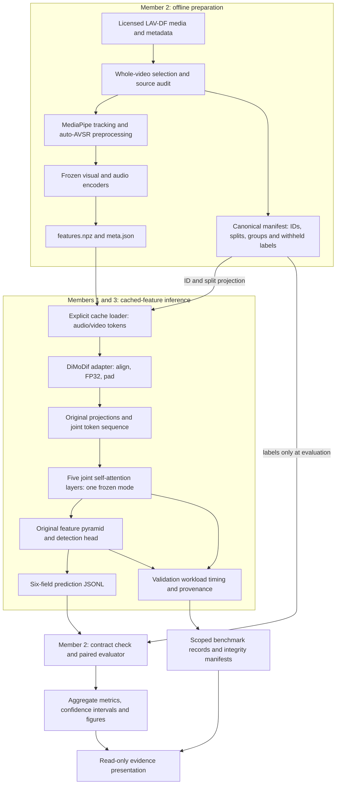
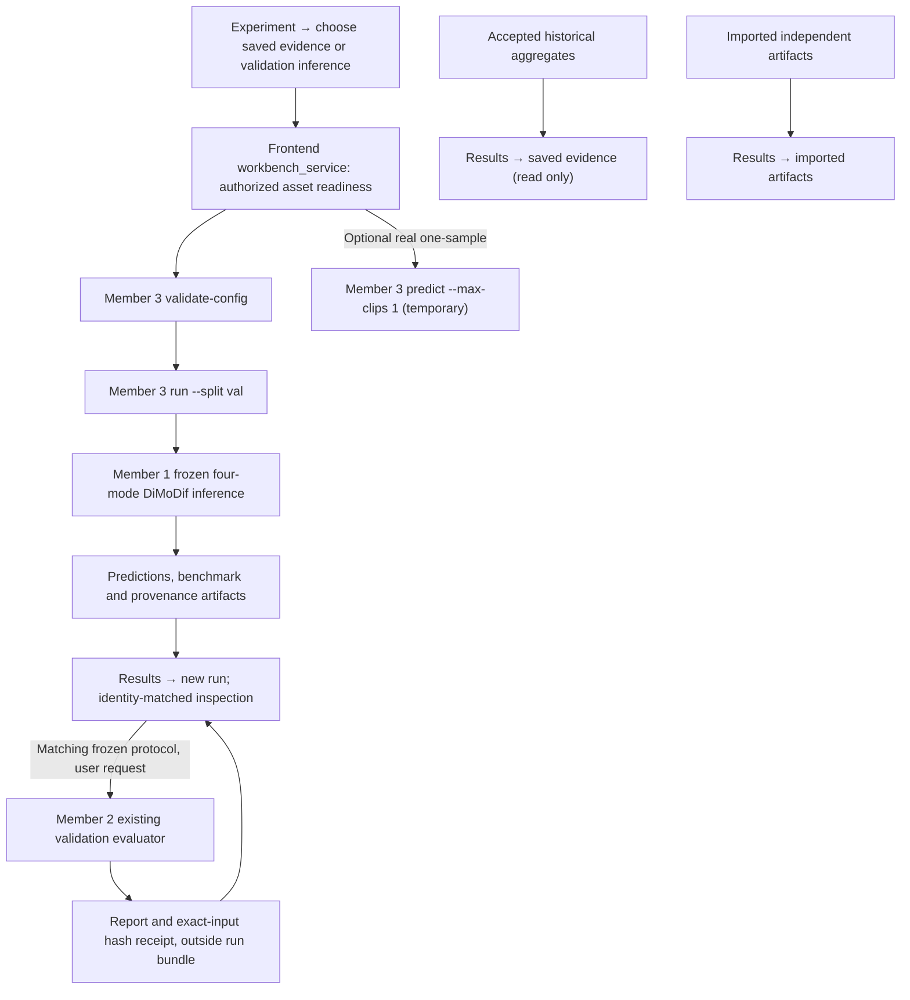

# 4. Final system architecture

## A system with an offline boundary

AVFuse-CausalQ runs a frozen pretrained detector on cached encoder features, then sends its saved scores to a separate statistical evaluator. Keeping these boundaries explicit avoids two common errors: calling feature-based inference a raw-video service, and treating an inference score as an accuracy measurement. The three ownership packages remain intact.

This diagram describes the **unchanged scientific pipeline**, not a raw-media inference API. The new DeepTrace workbench on `feature/deeptrace-precision-workbench` coordinates authorized validation-only inference and optional exact-protocol evaluation without replacing the model or evaluator.

## Offline features and manifest

Member 2's whole-video manifest gives clips stable IDs, split, manipulation labels and source grouping. The accepted `feature_path` field still carries a planned `.pt` path. For the actual DiMoDif cache, loaders construct `<feature_root>/<split>/<clip_id>/features.npz` explicitly. This intentional mapping is essential: blindly opening `feature_path` would use the wrong format or a nonexistent file.

The NPZ holds `video_features` with shape \([T_v,768]\) and `audio_features` with shape \([T_a,768]\). The extraction code uses auto-AVSR visual `LRS3_V_WER19.1` and audio `LRS3_A_WER1.0` models after the upstream-compatible preprocessing, including MediaPipe landmarks for visual tracking. Its `meta.json` records extraction status, shapes and independent stage timings. `dimodif_features.py` handles bookkeeping; `scripts/m2_dimodif_features.py` runs the heavy extraction. The older generic `preprocess.py` interface is not the working encoder pipeline.

The runtime loader validates nonempty, finite, floating arrays with 768 channels, disables pickle loading, and exposes only `video_tokens` and `audio_tokens`. The supported `shared_pt` loader remains for compatibility. No label is part of the model input.

## The frozen detector and tensor path

`DiMoDifAdapter` dynamically imports `AVDeepFakeDetector` from the supplied upstream `src/models.py`, reconstructs its saved config and loads its `model` state dictionary strictly. It switches to evaluation mode and freezes every parameter. The accepted LAV-DF checkpoint hash is `e1e59006d1bb6ad36a3859af5486a6649ed41bba23258b7c41e24f873be7948e`. Another checkpoint name exposed by the adapter is a software option, not an evaluated result in this study.

For a clip, the adapter accepts \([T,768]\), adds a batch dimension, and computes \(T=\min(T_v,T_a,600)\). It truncates both streams to \(T\), casts/moves them to FP32 on the explicit device, then zero-pads each to 600 positions. The selected upstream model projects each modality from 768 to a 64-dimensional representation. It concatenates a classification token, 600 video positions, a separator and 600 audio positions, adds learned positional information, and processes the sequence through five transformer layers. Four heads give each Q/K/V tensor shape \([B,4,1202,16]\).

The original structural mask is preserved. At the audited boundary it is not equivalent to masking all padding: the sample has no separate key-padding mask and some padded positions remain attendable. The cleanup does not “fix” that behavior, because doing so would change the pretrained model and accepted experiment.

## What the intervention changes

For one head, attention is

\[
P=\operatorname{softmax}\left(\frac{QK^\mathsf{T}}{\sqrt{d_h}}+M\right),\qquad O=PV.
\]

Here \(Q\) and \(K\) determine compatibility, \(d_h=16\) controls score scaling, \(M\) contributes blocked-position bias, and \(V\) supplies the information being mixed. For example, a token describing a mouth shape can assign weight to relevant speech tokens. Improving query resolution might alter those weights; improving value resolution might preserve what is transmitted after weights are selected. These are intuition, not measured explanations of individual predictions.

The attention wrapper supports a dense implementation for correctness and `scaled_dot_product_attention` for execution. The DiMoDif intervention temporarily intercepts each original `MultiheadAttention.forward`. It uses the original packed QKV projection and bias, reshapes heads, translates the mask, calls the common attention implementation, joins heads and applies the original output projection. It rejects unsupported training/causal/weight-return configurations. A context manager restores original forwards after the call.

For a floating tensor \(x\), the implementation uses

\[
s=\frac{\max(\max |x|,\mathrm{tiny}_{dtype})}{127},\quad
\widehat{x}=s\,\operatorname{clip}(\operatorname{round}(x/s),-127,127).
\]

The maximum is computed per entire tensor at each call, so each boundary receives a fresh dynamic scale. The zero case remains zero. The output \(\widehat{x}\) is still a floating tensor. No weight quantization, integer accumulator, static calibration table or compiled INT8 kernel is introduced.

| Mode | Q | K | V | Attention output O before output projection |
| --- | --- | --- | --- | --- |
| `reference` | FP32 | FP32 | FP32 | FP32 |
| `low_precision` | fake INT8 | fake INT8 | fake INT8 | fake INT8 |
| `restore_value_output` | fake INT8 | fake INT8 | FP32 | FP32 |
| `restore_query` | FP32 | fake INT8 | fake INT8 | fake INT8 |

This table specifies rounded activation boundaries, not tensor storage types. Every mode retains FP32 projections/weights, floating attention score arithmetic and softmax, output projection, residuals, layer normalization, feed-forward layers and detection head. The authoritative reference prediction uses the original model forward; the instrumented FP32 forward is separately checked for parity. Other modes enter the patched path. Dense-versus-SDPA checks establish numerical agreement within the recorded tolerance, not bit identity across every platform.

Each of the five layers uses the same selected policy. Later layer inputs can therefore differ across modes. “Restore” means retaining the unrounded activation at that layer in that mode, not replacing it with a cached independent reference activation. V/output is a bundled intervention and Q is not proven equal-cost.

## Detection and prediction contract

With feature pyramids enabled, the original classifier produces two modality outputs across pyramid levels. The adapter applies sigmoid, averages probabilities over the pyramid dimension, then takes the maximum of the two modality probabilities as `score_fake`. This matches upstream DFD scoring. It is neither an average of raw logits nor a newly trained calibration model.

Member 3 orchestrates these calls through the stable `ModelAdapter.predict_from_cached_features(features, mode)` interface. Prediction rows contain `run_id`, `clip_id`, `split`, `config`, `score_fake` and `checkpoint_sha256`. Exact coverage and uniqueness checks prevent silently dropping a difficult clip. Member 2 joins those scores to labels separately, checks checkpoint/split identities, and computes metrics and paired intervals.

## Runtime and presentation boundaries

The current Member 3 CLI provides `validate-config`, `predict`, `run`, `benchmark` and `inspect`; module invocation also supports a clearly labeled toy `--smoke` check. Run artifacts retain configuration, environment, predictions, timing records and integrity hashes. Incomplete subsets and unsupported modes are not finalized as full experiments. The current generic runtime is integrated from later source; it is not asserted to be byte-identical to the old frozen execution package.

Model timing consumes resident tokens and includes preparation/padding, attention/head and applicable fake-quant conversions. Operator timing excludes projections and the full model. Offline extraction and independent preprocessing measurements remain separate. The accepted measurements do not include a complete raw-media path or measured CPU peak tensor memory.

Backend APIs, CLI contracts and artifacts remain unchanged. The redesigned frontend adds only orchestration and presentation within `frontend/`. Licensed model source, frozen checkpoint and complete compatible validation caches are still required for a real new inference run; raw-video upload is not supported.

## DeepTrace — frontend orchestration and evidence boundaries

The workbench is a **three-page Streamlit control plane**: Experiment, Results, About. It reuses the scientific architecture above.

The UI-facing modules are `frontend/app.py` and `avfuse_ui/ui.py` (navigation, durable draft and authorization), `workbench_service.py` (missing-cache inventory, checkpoint/device checks, bounded sample load, optional genuine forward and evaluator handoff), `backend_status.py` (structured subprocess invocations), `workbench_results.py` (source-bound presentations and available downloads), plus `data_access.py` and `run_inspection.py` (safe readers, schemas and dated explicit integrity checks). No HTTP server or alternative detector was introduced.

**Separation of evidence:** a valid config is not proof the model ran; one sample forward is not full-cohort completion; inference is not label-grounded evaluation; finalization is not integrity verification. The optional Member 2 evaluation needs a pre-existing frozen protocol tied to the exact validation-only manifest/checkpoint and threshold. Its report is written under `artifacts/member3/evaluations/<run>/<unique-id>/`, outside the finalized run bundle, and linked to the original prediction file only with a matching hash receipt.

**Verification limit:** the frontend integration record reports 1,235 local passing tests, 22 skips, live browser checks and synthetic-fixture evaluator wiring. It does **not** establish a completed new licensed-checkpoint inference experiment through the redesigned UI. The original held-out results remain preserved historical research evidence.
