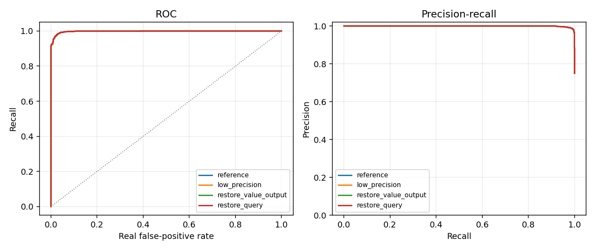
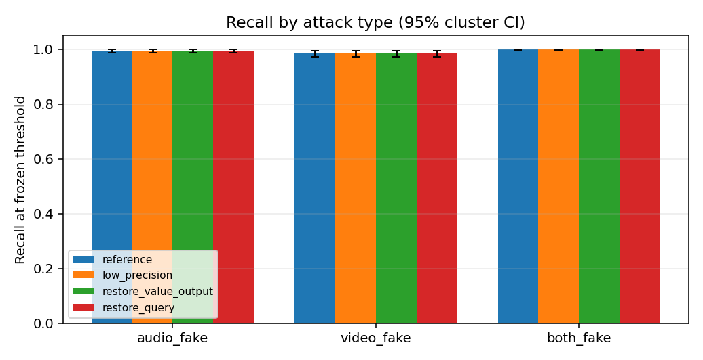

# 6. Experiments and results

## Evidence basis and interpretation rules

This chapter reports saved original experiments, not a new evaluation. The final Member 2 `test/metrics.json` has SHA-256 `fae7f7f8ed9f302ed4a298f8ee66f00d3b59ba679ff2f4424aad054f26355080`; all eleven final-package payload checksums were checked. Member 3 workload hashes match the accepted release. [Machine-readable presentation tables](results/README.md) preserve full stored values and all 80 paired comparisons. [Chapter 10](10_EVIDENCE_AND_REFERENCES.md) identifies every source and verification limit.

Higher AUROC/AP/recall is favorable; lower BCE/real FPR is favorable. Confidence intervals are source-grouped percentile intervals. A CI crossing zero fails to establish a directional paired effect; it does not demonstrate equivalence. Printed equality is not exact equality. The original threshold, cohort and mode definitions remain frozen throughout this account.

## Experiment 1: detector and attention feasibility

The first checks asked whether the selected pretrained model actually responds to both modalities, where its attention occurs, and whether a custom kernel was justified. The ten-clip saved modality-ablation report records mean audio/video logit changes of 7.794241 and 9.044412, and mean modality-output changes of 0.359741 and 0.375591. These diagnostic magnitudes depend on the pilot and chosen output summaries. They show input dependence in those samples, not a ten-clip estimate of detection accuracy or proof that all predictions use genuine cross-modal semantics.

| Original feasibility record | Verified finding | Interpretation |
| --- | --- | --- |
| Day 2 attention audit | five self-attention layers; Q/K/V `[1,4,1202,16]`; FP32 | intervention acts on joint AV self-attention |
| Day A memory analysis | dense score storage 22.046 MiB/layer; QKV about 0.880 MiB | analytical storage, not measured SDPA peak memory |
| Day A padding audit | inspected sample 235 valid and 365 padded positions/modality | valid length differs from padded attention length |
| Day A model parity | all five native-versus-SDPA boundary errors zero; final logits/score difference zero on recorded pilot | accepted pilot correctness check, not universal bit identity |
| Dense-versus-SDPA check | largest saved layer max-absolute error 0.0000343323 | floating reduction order permits small differences |

The values establish a concrete computation to instrument and a correctness reference. The team retained SDPA plus the dense oracle and made a no-go scope decision for a custom kernel. They do not prove absence of a memory bottleneck on every device or reproduce a FlashAttention speedup. The actual padded matrix is appreciably larger than the proposal's rough token-count illustration; this is disclosed rather than replacing the measurement with the original expectation.

## Experiment 2: the FP32 validation baseline

The original pretrained DiMoDif LAV-DF DFD model supplies the baseline. No detector was trained for this project. The accepted validation cohort contains 300 authentic and 900 fake videos. Its reference threshold was selected at 5% authentic false positives and then fixed for all modes.

| Mode | AUROC | Average precision | BCE | Recall | Real FPR |
| --- | --- | --- | --- | --- | --- |
| reference | 0.9983703704 | 0.9994594524 | 0.0608488219 | 0.9933333333 | 0.0500000000 |
| low_precision | 0.9983814815 | 0.9994633777 | 0.0608056775 | 0.9933333333 | 0.0533333333 |
| restore_value_output | 0.9983740741 | 0.9994607979 | 0.0608495941 | 0.9933333333 | 0.0500000000 |
| restore_query | 0.9983814815 | 0.9994628138 | 0.0606382884 | 0.9933333333 | 0.0500000000 |

These values measure the same 1,200 videos in each mode. The reference AUROC near one reflects strong ranking on this selected in-dataset cohort. Its 0.993333 recall and 0.05 FPR are operating-point results, while its BCE evaluates probability confidence against labels. Validation was exposed to upstream checkpoint selection, so this table is development evidence, not an independent generalization estimate. The other rows are included to make the precision experiments directly comparable.

## Experiment 3: low-precision sensitivity

Low precision applies dynamic symmetric fake INT8 at Q/K/V and attention output in all five layers. The direct validation BCE damage is \(D=L_{low}-L_{ref}=-0.0000431443534570\), with 95% paired CI \([-0.0006248129777084,+0.0004649242890686]\). Its point estimate slightly favors low precision, while low-precision real FPR increases from 0.050000 to 0.053333 at the common threshold.

A changed probability or FPR point estimate demonstrates that the intervention can alter behavior. The interval does not establish systematic overall loss degradation; its two sides admit small benefit or harm. It would be incorrect to interpret the small negative validation estimate as a proven improvement or to conclude that quantization never affects forensic cues. Only this activation scheme, checkpoint and cohort are represented.

## Experiment 4: V/output restoration

The intended recovery was \(R_V=L_{low}-L_V\). Validation gives \(-0.0000439166091455\), CI \([-0.0004760947937909,+0.0004228511825303]\). Retaining V/output resolution therefore did not demonstrate reduced label-grounded loss relative to low precision. This matters because a closer-to-reference internal tensor could still worsen predictions when reference errors exist.

The restoration retains V and the pre-projection output together while rounding Q/K. It does not restore pretrained weights, which were already full precision, and does not rewind earlier hidden states. The result cannot be assigned to V alone or interpreted as failure of every possible restoration scheme.

## Experiment 5: query restoration control

Query restoration retains Q but rounds K/V/output. Its validation recovery estimate is \(+0.0001673890778679\), CI \([-0.0004480310336885,+0.0007681759813717]\). The direct H3 contrast is \(R_V-R_Q=L_Q-L_V=-0.0002113056870134\), CI \([-0.0010083570282119,+0.0006097277131265]\).

The Q point estimate is more favorable on validation BCE, but neither its recovery nor the direct preference is established statistically. The mathematical comparison is useful precisely because the two configurations improve different boundaries. It is not a verified equal-cost experiment: V/output restores two boundaries and the measured runtime costs are unequal/noisy.

## Experiment 6: validation decision and freeze

C9 froze the four modes and a **reference-preferred** interpretation, with H2/H3 recorded `not_supported`. This follows the lack of demonstrated damage and restoration advantage; it is not a claim that reference is statistically superior. The threshold remains 0.6627789735794068. The frozen policy explicitly retains source-versus-speaker limits, validation checkpoint-selection bias, prior test-summary exposure, cumulative intervention and fake-INT8 scope.

No additional configuration was selected from final test scores. The study continued to measure the frozen contrasts despite the unexpected lack of the motivating degradation. That makes the negative result an interpretable answer to the question rather than a reason to replace the question after seeing results.

## Experiment 7: held-out predictions and final evaluation

After a missing-input parent failure and an interrupted R1, accepted R2 completed exactly 2,000 rows per mode under run `C10_RECOVERY_R2_C10_20261113T191638908596Z`. Member 2's saved final check binds all 8,000 rows to one checkpoint and canonical cohort. The final evaluation has 500 authentic/1,500 fake videos and 1,738 source clusters. It uses 1,000 bootstrap replicates, seed 0; all stored metric-block valid replicate counts are 1,000.

### Ranking metrics

| Mode | AUROC [95% CI] | Average precision [95% CI] |
| --- | --- | --- |
| reference | 0.998044000 [0.996938718, 0.998913783] | 0.999352103 [0.998986471, 0.999638217] |
| low_precision | 0.998033333 [0.996937863, 0.998913848] | 0.999348271 [0.998980245, 0.999634747] |
| restore_value_output | 0.998037333 [0.996919311, 0.998925644] | 0.999349608 [0.998984187, 0.999637170] |
| restore_query | 0.998040000 [0.996928387, 0.998917389] | 0.999350411 [0.998982875, 0.999638372] |

AUROC and average precision measure score ordering, with AP also depending on the 75% fake prevalence. Their unrounded values differ across modes even though the historical report displays many rows as 0.9980/0.9994. These intervals describe uncertainty in each mode's population statistic. They do not establish equivalence or provide the preferred test of a paired difference.

### Loss and fixed-threshold behavior

| Mode | BCE [95% CI] | Recall [95% CI] | Real FPR [95% CI] |
| --- | --- | --- | --- |
| reference | 0.067792265 [0.045119441, 0.093791018] | 0.992000 [0.987282, 0.996099] | 0.042000 [0.024539, 0.060723] |
| low_precision | 0.068121211 [0.045487295, 0.094528357] | 0.992000 [0.987282, 0.996099] | 0.042000 [0.024539, 0.060723] |
| restore_value_output | 0.068176098 [0.045196623, 0.094768580] | 0.992000 [0.987282, 0.996099] | 0.042000 [0.024539, 0.060723] |
| restore_query | 0.067693347 [0.045209410, 0.093826010] | 0.992000 [0.987282, 0.996099] | 0.042000 [0.024539, 0.060723] |

BCE captures changes in confidence against the true label that rank or threshold metrics can miss. All four modes have the same aggregate recall and FPR at the fixed threshold, but equal rates alone would not show that the same individual errors occurred. The paired table below provides the saved comparison. The reference test FPR is 4.2%, with an interval spanning roughly 2.45–6.07%; carrying a validation target into test is not a guarantee of a future deployment rate below 5%.

### Overall paired comparisons

| BCE contrast (b − a) | Delta | 95% paired CI |
| --- | --- | --- |
| low_precision − reference | +0.000328945787 | [-0.000237371472, +0.000962465411] |
| restore_value_output − low_precision | +0.000054887038 | [-0.000386234663, +0.000493064066] |
| restore_query − low_precision | -0.000427863990 | [-0.000977544352, +0.000092703089] |
| restore_value_output − restore_query | +0.000482751028 | [-0.000164867252, +0.001185027814] |

A positive BCE difference means mode b is worse. Low precision has a small positive damage point estimate on test, unlike validation, but the interval still crosses zero. V/output-minus-low is slightly positive, so its point estimate does not even suggest a loss recovery; Q-minus-low is negative but uncertain. The direct V/output-minus-Q contrast also crosses zero. These comparisons do not support overall V/output superiority, successful rescue or general equivalence.

| Contrast (b − a) | Metric | Delta | 95% paired CI |
| --- | --- | --- | --- |
| low_precision − reference | auroc | -0.000010667 | [-0.000060621, +0.000033015] |
| low_precision − reference | auprc | -0.000003832 | [-0.000021127, +0.000010729] |
| low_precision − reference | recall | +0.000000000 | [+0.000000000, +0.000000000] |
| low_precision − reference | real_fpr | +0.000000000 | [+0.000000000, +0.000000000] |
| restore_value_output − low_precision | auroc | +0.000004000 | [-0.000024969, +0.000038846] |
| restore_value_output − low_precision | auprc | +0.000001337 | [-0.000008190, +0.000012548] |
| restore_value_output − low_precision | recall | +0.000000000 | [+0.000000000, +0.000000000] |
| restore_value_output − low_precision | real_fpr | +0.000000000 | [+0.000000000, +0.000000000] |
| restore_query − low_precision | auroc | +0.000006667 | [-0.000031706, +0.000052592] |
| restore_query − low_precision | auprc | +0.000002140 | [-0.000010539, +0.000017408] |
| restore_query − low_precision | recall | +0.000000000 | [+0.000000000, +0.000000000] |
| restore_query − low_precision | real_fpr | +0.000000000 | [+0.000000000, +0.000000000] |
| restore_value_output − restore_query | auroc | -0.000002667 | [-0.000042219, +0.000035811] |
| restore_value_output − restore_query | auprc | -0.000000803 | [-0.000013902, +0.000011691] |
| restore_value_output − restore_query | recall | +0.000000000 | [+0.000000000, +0.000000000] |
| restore_value_output − restore_query | real_fpr | +0.000000000 | [+0.000000000, +0.000000000] |

The paired ranking intervals also cross zero. Saved recall/FPR differences and intervals are zero on these empirical resamples. That describes this score/threshold/cohort comparison; it supplies no equivalence margin, guarantee for new videos or proof of identical scores. The values were read from saved comparisons, not recalculated by joining test predictions to labels during documentation.

### Manipulation-specific results

| Mode | Fake category vs all real | AUROC [95% CI] | AP [95% CI] | Recall [95% CI] |
| --- | --- | --- | --- | --- |
| reference | audio_fake | 0.999028 [0.998258, 0.999648] | 0.999063 [0.998289, 0.999659] | 0.994000 [0.986000, 1.000000] |
| reference | video_fake | 0.995472 [0.992596, 0.997656] | 0.995621 [0.992946, 0.997750] | 0.984000 [0.972222, 0.993976] |
| reference | both_fake | 0.999632 [0.999259, 0.999919] | 0.999640 [0.999263, 0.999920] | 0.998000 [0.993964, 1.000000] |
| low_precision | audio_fake | 0.998988 [0.998165, 0.999639] | 0.999027 [0.998229, 0.999643] | 0.994000 [0.986000, 1.000000] |
| low_precision | video_fake | 0.995488 [0.992603, 0.997671] | 0.995630 [0.992934, 0.997744] | 0.984000 [0.972222, 0.993976] |
| low_precision | both_fake | 0.999624 [0.999226, 0.999922] | 0.999633 [0.999234, 0.999923] | 0.998000 [0.993964, 1.000000] |
| restore_value_output | audio_fake | 0.999012 [0.998231, 0.999643] | 0.999047 [0.998284, 0.999650] | 0.994000 [0.986000, 1.000000] |
| restore_value_output | video_fake | 0.995472 [0.992644, 0.997654] | 0.995618 [0.992915, 0.997756] | 0.984000 [0.972222, 0.993976] |
| restore_value_output | both_fake | 0.999628 [0.999241, 0.999916] | 0.999636 [0.999246, 0.999919] | 0.998000 [0.993964, 1.000000] |
| restore_query | audio_fake | 0.999024 [0.998243, 0.999641] | 0.999059 [0.998289, 0.999654] | 0.994000 [0.986000, 1.000000] |
| restore_query | video_fake | 0.995472 [0.992570, 0.997671] | 0.995614 [0.992977, 0.997741] | 0.984000 [0.972222, 0.993976] |
| restore_query | both_fake | 0.999624 [0.999235, 0.999919] | 0.999633 [0.999227, 0.999920] | 0.998000 [0.993964, 1.000000] |

Each rank row compares one 500-video fake category with all 500 authentic videos. Recall uses the fake category at the same fixed threshold. Video-only fakes are descriptively harder in the reference row: AUROC 0.995472 and recall 0.984, compared with 0.999028/0.994 for audio-only and 0.999632/0.998 for both-fake. A baseline difficulty difference is not evidence that precision affects categories differently. AP in these balanced subsets must not be numerically compared with overall AP as if class prevalence were unchanged.

| BCE contrast (b − a) | Subset | Delta | 95% paired CI |
| --- | --- | --- | --- |
| low_precision − reference | audio_fake | +0.000304661 | [-0.000734950, +0.001453104] |
| low_precision − reference | video_fake | +0.000486204 | [-0.000676931, +0.001888254] |
| low_precision − reference | both_fake | +0.000204729 | [-0.000778326, +0.001361743] |
| restore_value_output − low_precision | audio_fake | +0.000431273 | [-0.000136338, +0.001119204] |
| restore_value_output − low_precision | video_fake | +0.000123647 | [-0.000753891, +0.000930812] |
| restore_value_output − low_precision | both_fake | +0.000361729 | [-0.000189815, +0.000983659] |
| restore_query − low_precision | audio_fake | -0.000736476 | [-0.001651712, +0.000126615] |
| restore_query − low_precision | video_fake | -0.000596659 | [-0.001705606, +0.000293931] |
| restore_query − low_precision | both_fake | -0.000493632 | [-0.001467619, +0.000212358] |
| restore_value_output − restore_query | audio_fake | +0.001167749 | [+0.000152772, +0.002482882] |
| restore_value_output − restore_query | video_fake | +0.000720306 | [-0.000442405, +0.001988634] |
| restore_value_output − restore_query | both_fake | +0.000855361 | [-0.000089416, +0.002054308] |

These subset BCE contrasts use both that category and the real cohort, unlike the fake-only recall denominator. The lone nominal zero-excluding interval among all 80 saved paired tests is audio-fake BCE(V/output)−BCE(Q): +0.001167748753, CI [+0.000152771688,+0.002482882336]. It favors Q on that metric, contrary to the proposed V/output advantage. It is exploratory: comparisons are correlated, there is no multiplicity correction, and no formal between-category interaction is established. An isolated exception is neither a reliable general superiority claim nor automatically a false positive.

The original final figures are preserved below; their bytes match the checked package. They summarize the same held-out outputs and supply no additional experiment.

## Experiment 8: shortcut and validity checks

The saved reference control matches real/fake counts within ten trailing-silence bins. It retains 912 of the 2,000 test videos. The table is a comparison of the original all-cohort and selected matched-cohort metrics.

| Quantity | All 2,000 | Matched 912 |
| --- | --- | --- |
| Trailing-silence-only AUROC | 0.659703333 | 0.506073984 |
| Reference detector AUROC | 0.998044000 | 0.997234726 |
| Detector 95% CI | [0.996938718, 0.998913783] | [0.995522553, 0.998598285] |

The measured detector AUROC drop is 0.000809274 while the selected shortcut becomes near chance. This weakens the explanation that trailing silence alone accounts for the retained detector ranking in that subset. Matching changes the population and does not remove every related signal. Duration and other shortcuts remain uncontrolled, no general silence independence is established, and the final control is reference-only. It must not be advertised as a four-mode causal shortcut ablation.

Source audits separately report no selected-source overlap with checkpoint training and no validation/test source leakage. Those checks do not establish speaker-disjointness. The coverage report's interrupted full-array audit and historical test-summary exposure remain qualifications rather than being concealed by the final successful run.

## Experiment 9: runtime benchmarking

The accepted three-workload benchmark was recorded on validation anchors, not by repeatedly opening test. Environment metadata identifies Intel Xeon CPU @ 2.20 GHz, Linux 6.6.159+, Python 3.13.18 and torch 2.14.1+cpu, SDPA, FP32 execution, batch one and one intra/inter-op thread in the release. Each mode/workload has ten warmups and fifty saved observations: twelve records and 600 timed samples in total. Recomputing linear p50/p95 from those existing observations matches the originals; no benchmark was rerun.

| Workload | Mode | Samples | p50 ms | p95 ms |
| --- | --- | --- | --- | --- |
| short | reference | 50 | 115.841651 | 180.203788 |
| short | low_precision | 50 | 120.460469 | 196.072536 |
| short | restore_value_output | 50 | 117.882037 | 133.967148 |
| short | restore_query | 50 | 171.228341 | 192.263562 |
| typical | reference | 50 | 118.454390 | 139.775614 |
| typical | low_precision | 50 | 161.434481 | 189.416556 |
| typical | restore_value_output | 50 | 119.918150 | 131.850522 |
| typical | restore_query | 50 | 167.474019 | 188.496067 |
| long | reference | 50 | 121.195739 | 133.345475 |
| long | low_precision | 50 | 158.257662 | 198.109193 |
| long | restore_value_output | 50 | 121.530770 | 136.909003 |
| long | restore_query | 50 | 157.677357 | 200.424443 |

These are cached-feature **model** times, including resident-feature preparation/padding, fusion/head and applicable quantize/dequantize work. They exclude media decode, tracking, encoders, cache loading and pre-timed transfers. Short/typical/long video/audio lengths are 78/80, 192/192 and 493/494 respectively, yet attention stays padded to 1,202 positions. The table is not an attention-sequence scaling study. Tail variation and scheduling noise also prevent treating single-cell differences as stable population speedups.

At the typical anchor, low precision costs more than reference, and V/output is close to reference. Retaining V/output avoids two fake-quant boundaries, so a negative V/output-minus-low overhead is plausible in floating simulation. The recorded differences are −41.516331 ms for V/output-minus-low and +6.0395385 ms for Q-minus-low. They do not provide comparable positive extra costs. Dividing uncertain loss recovery by these unequal/noisy overheads would not establish an equal-budget restoration policy.

The original isolated operator benchmark provides a different view:

| Operator backend | Mode | Samples | p50 ms | p95 ms |
| --- | --- | --- | --- | --- |
| SDPA | reference | 50 | 15.884936 | 17.191668 |
| SDPA | low precision | 50 | 15.530448 | 18.273216 |
| Dense oracle | reference | 50 | 60.531723 | 67.414256 |
| Dense oracle | low precision | 50 | 78.534200 | 108.380835 |

These times exclude projections and the full model and cannot be added to model timings or compared as if they were the same workload boundary. Two further original diagnostics add 300 and 40 saved operator samples; all three files together have 540 operator samples, separate from the model's 600. Their source hashes are indexed in Chapter 10. The small SDPA low-precision p50 advantage in this one operator record does not contradict slower model-level floating simulation or establish a native INT8 speedup.

Fake quantization adds reductions, division, rounding, clipping and multiplication while leaving the matrix multiplications floating point. It therefore provides no inherent hardware acceleration. CPU peak memory is null/unmeasured. The dense storage estimate is analytical, and independent preprocessing medians from a mixed CPU/T4 environment cannot be summed into an end-to-end percentile. No complete raw-media runtime, native INT8 speedup, memory reduction or stable cost-normalized restoration advantage is demonstrated.

## What the complete experiment establishes

The saved outputs support a narrow result: this frozen detector/cohort is only weakly affected in its aggregate metrics by this specific simulated precision reduction, with no statistically supported overall damage or V/output restoration advantage. The study establishes the observed mode behavior, source-aware uncertainty and scoped runtime costs. It does not establish zero effect, general robustness, component-level causal importance, or a deployment optimization. The hypothesis and limitation analysis follows in [Chapter 7](07_FAILURES_LIMITATIONS_AND_HYPOTHESES.md).
